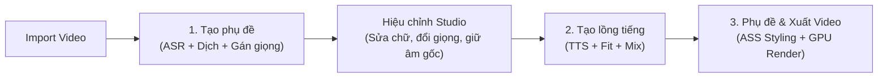

# DubStudio — Trình Lồng Tiếng & Vietsub Video AI (Trung → Việt)

[](https://github.com/Lurz0205/DubStudiobyHTB/releases)
[-38bdf8.svg)](https://github.com/Lurz0205/DubStudiobyHTB/releases)
[](LICENSE)
[](https://www.python.org/)

**DubStudio** là ứng dụng desktop Windows mã nguồn mở, hoạt động theo triết lý **cục bộ (Local-first)**, chuyên chuyển đổi tự động các video tiếng Trung (video ngắn, review phim, vlog đời sống, clip công nghệ, hoạt hình...) sang video thuyết minh/lồng tiếng Việt chuẩn ngữ cảnh, tự nhiên kèm phụ đề định dạng nâng cao (ASS).

Toàn bộ các mô hình AI hạng nặng (tách nhạc nền Kim_Vocal_2 / BS-RoFormer, nhận dạng giọng nói SenseVoice-Small / Whisper large-v3-turbo, tổng hợp giọng đọc thuyết minh VieNeu-TTS-v3 Turbo) đều được tối ưu hóa chạy trực tiếp trên GPU máy tính người dùng (NVIDIA RTX 4GB VRAM trở lên), đảm bảo tốc độ vượt trội, bảo mật dữ liệu tuyệt đối và hoàn toàn miễn phí trọn đời.

---

## 📥 Tải bản cài đặt sẵn cho Windows (Khuyến nghị)

Nếu bạn không muốn cài đặt Python hoặc cấu hình môi trường phức tạp:
👉 **[Tải xuống bản cài đặt DubStudio v1.1.0 (DubStudio-win-Setup.exe)](https://github.com/Lurz0205/DubStudiobyHTB/releases/tag/v1.1.0)**

- Tải về và nhấp đúp file setup để cài đặt trong vòng 10 giây (tích hợp Velopack tự động cập nhật vi sai mượt mà).
- Hoàn toàn độc lập, tích hợp sẵn FFmpeg nội bộ, tự động tải mô hình AI vào `%LocalAppData%\DubStudio`.

---

## 🌟 Toàn cảnh tính năng nổi bật trên bản v1.1.0

### 1. Hỗ trợ đa mô hình nhận dạng giọng nói (ASR): SenseVoice & Whisper
- **SenseVoice-Small siêu tốc**: Nhận diện tiếng Trung cực nhanh với độ trễ thấp, tích hợp sẵn VAD thông minh.
- **Faster-Whisper large-v3-turbo**: Tùy chọn chuyển đổi linh hoạt dành cho các video nhiều tạp âm hoặc giọng địa phương phức tạp.
- **Tải mô hình chọn lọc theo nhu cầu**: Hệ thống chỉ tải mô hình bạn đang chọn làm việc, tiết kiệm tối đa dung lượng ổ cứng.

### 2. Quản lý tài nguyên GPU & VRAM 4GB tối ưu
- **Stage Mutex Kernel**: Tự động giải phóng worker TTS thường trực trước khi bước vào các giai đoạn nặng như tách nhạc hoặc ASR; gọi dọn VRAM (`torch.cuda.empty_cache()`) và RAM sau mỗi khâu.
- **Windows Job Object (`KILL_ON_JOB_CLOSE`)**: Khi đóng ứng dụng, toàn bộ các tiến trình xử lý ngầm (FFmpeg, worker AI) đều được dọn dẹp sạch sẽ 100%, không bị tình trạng treo ngầm ngốn tài nguyên.

### 3. Trình phát Video Preview đa kênh thông minh (Synchronized Multi-track)
- **Tự động thích ứng**: Giữ nguyên âm thanh gốc 100% của video khi vừa nạp dự án mới; tự động chuyển sang chế độ đa track con (tiếng Việt, nhạc nền, tiếng gốc) khi hoàn tất tách nhạc/lồng tiếng.
- **Khoanh vùng Giữ âm gốc độc lập (Original Audio Passthrough)**: Tạo vùng giữ âm thanh gốc trực tiếp trên Timeline Track 3 với chuyển tiếp Raised-Cosine S-Curve 150ms triệt tiêu tiếng click/pop.

### 4. Nhận diện Giới tính & Nhân vật thông minh theo ngữ cảnh (Context-Aware Gender)
- **Gemini Context Tagging**: Tận dụng trí tuệ ngữ cảnh của Gemini ngay trong quá trình dịch thuật. AI tự động phân tích vai vế xưng hô, đại từ nhân xưng (他/她, cô/chú/anh/chị/em), tên gọi và ngữ cảnh đối thoại để xác định chính xác người nói là nam hay nữ mà không tốn thêm tài nguyên đo F0 âm thanh.

### 5. Cổng kiểm soát an toàn trước khi chạy (Pre-flight Safety Gates)
- **Chặn bấm nhầm quy trình**: Cảnh báo nhắc nhở ngay từ giao diện nếu người dùng bấm "2. Tạo lồng tiếng" khi chưa có phụ đề bước 1, ngăn chặn lỗi thiếu file và không làm gián đoạn màn hình xem trước video.
- **Khóa tải đơn tiến trình (`_GLOBAL_DOWNLOADING_LOCK`)**: Chống tải trùng lặp hoặc xung đột đa luồng khi người dùng tương tác liên tục.
- **Tự phục hồi giao diện khi gặp sự cố**: Tự động khôi phục video preview và bảng phụ đề ngay lập tức nếu tiến trình xử lý gặp lỗi, người dùng không cần thoát ra mở lại dự án.

### 6. Hai chế độ Dịch thuật linh hoạt: Tự động qua Gemini & Tự dịch thủ công
- **Dịch tự động qua Gemini**: Hỗ trợ kết nối trực tiếp qua Google Gemini API hoặc chế độ duyệt web không cần API Key, tự động dịch thoát ý, chuẩn văn phong đời thường của người Việt.
- **Chế độ Tự dịch thủ công (Manual Translation)**: Không cần API key, không cần tài khoản. Xuất toàn bộ lời thoại tiếng Trung kèm prompt chuẩn để copy sang ChatGPT/Claude/DeepSeek và dán ngược lại ứng dụng trong 1 click.

### 7. Xuất Video & Khắc cứng phụ đề ASS bằng phần cứng
- Render bằng FFmpeg tận dụng phần cứng GPU NVIDIA (`h264_nvenc`) hoặc Intel QuickSync (`h264_qsv`), fallback mượt mà sang CPU (`libx264`).
- Tùy biến kiểu dáng phụ đề ASS: màu sắc, viền, khung nền bo góc (box styling) và độ nét cao.

---

## 🔄 Quy trình làm việc tiêu chuẩn (3 Bước)



1. **Bước 1 — Tạo phụ đề:** Chọn video tiếng Trung, chọn văn phong và bấm **"1. Tạo phụ đề"**.
2. **Bước 2 — Hiệu chỉnh & Tạo lồng tiếng:** Nghe thử, sửa chữ trực tiếp trên bảng, đổi giọng đọc hoặc khoanh vùng âm gốc rồi bấm **"2. Tạo lồng tiếng"**.
3. **Bước 3 — Xuất video:** Sang tab **"3. Phụ đề"** để chọn phong cách hiển thị chữ và bấm **"Xuất Video"**.

---

## ⌨️ Phím tắt & Thao tác chuột hữu ích

| Thao tác | Chức năng |
| :--- | :--- |
| **Phím Space (Cách)** | Phát / Tạm dừng video preview |
| **Phím Delete** | Xóa nhanh các lời thoại đang được chọn |
| **Ctrl + Click** | Chọn nhiều câu thoại cùng lúc trên bảng phụ đề |
| **Ctrl + F** | Mở thanh Tìm kiếm & Thay thế phụ đề |
| **Nhấp đúp vào dòng** | Mở hộp thoại chỉnh sửa chuyên sâu và ngắt nhịp câu |
| **Chuột phải trên bảng phụ đề** | Bật/tắt phụ đề, Bật/tắt giọng đọc TTS, Đổi giọng đọc hàng loạt, Xóa dòng |
| **Kéo chuột phải trên Track Âm gốc** | Tạo nhanh vùng giữ âm gốc trực tiếp trên Timeline |
| **Kéo 2 đầu mút khối trên Timeline** | Tùy chỉnh vị trí bắt đầu và kết thúc của lời thoại hoặc vùng âm gốc |

---

## 💻 Yêu cầu hệ thống

- **Hệ điều hành**: Windows 10 / Windows 11 (64-bit).
- **Bộ vi xử lý (CPU)**: Intel Core i5 thế hệ 10 / AMD Ryzen 5 3600 trở lên.
- **Bộ nhớ trong (RAM)**: Tối thiểu 8 GB (Khuyến nghị 12 GB - 16 GB trở lên).
- **Card đồ họa (GPU)**: NVIDIA GeForce RTX 2050 (4 GB VRAM) trở lên với driver hỗ trợ CUDA 12.x.
- **Dung lượng ổ cứng**: Tối thiểu 10 GB dung lượng trống (khuyến nghị ổ SSD).
- **Bản cài đặt sẵn**: Tích hợp sẵn toàn bộ công cụ, không yêu cầu cài đặt thêm môi trường.

---

## 🚀 Hướng dẫn khởi động từ mã nguồn

### 1. Yêu cầu môi trường
- Python **3.11** (Lưu ý: Không dùng Python 3.12 hoặc 3.14 do yêu cầu tương thích của PyTorch CUDA và CTranslate2).
- Cài đặt FFmpeg trên Windows.

### 2. Cài đặt các thư viện
```powershell
# Kích hoạt môi trường ảo
.\.venv\Scripts\Activate.ps1

# Cài đặt các gói phụ thuộc
pip install -r requirements.txt --progress-bar off
```

### 3. Khởi chạy ứng dụng
```powershell
# Chạy trực tiếp qua file khởi động
.\.venv\Scripts\python.exe start_app.py
```

### 4. Chạy kiểm thử tự động (Unit Tests)
```powershell
.\.venv\Scripts\python.exe -m pytest tests/ -q
```

---

## 📄 Bản quyền & Tuyên bố miễn trừ trách nhiệm

- Ứng dụng được phát triển hoàn toàn độc lập theo hình thức **Clean-room implementation**, không sao chép mã nguồn, tài nguyên hay giọng đọc từ bất kỳ phần mềm thương mại nào.
- Ứng dụng chỉ phục vụ mục đích biên dịch, học tập và sản xuất video cá nhân từ các tệp tin video nội bộ hợp pháp trên máy tính người dùng.

---
*Phát triển bởi đội ngũ DubStudio — Phiên bản v1.1.0.*

---

## ⌨️ Phím tắt & Thao tác chuột hữu ích

| Thao tác | Chức năng |
| :--- | :--- |
| **Phím Space (Cách)** | Phát / Tạm dừng video preview |
| **Phím Delete** | Xóa nhanh các lời thoại đang được chọn |
| **Ctrl + Click** | Chọn nhiều câu thoại cùng lúc trên bảng phụ đề |
| **Ctrl + F** | Mở thanh Tìm kiếm & Thay thế phụ đề |
| **Nhấp đúp vào dòng** | Mở hộp thoại chỉnh sửa chuyên sâu và ngắt nhịp câu |
| **Chuột phải trên bảng phụ đề** | Bật/tắt phụ đề, Bật/tắt giọng đọc TTS, Đổi giọng đọc hàng loạt, Xóa dòng |
| **Kéo chuột phải trên Track Âm gốc** | Tạo nhanh vùng giữ âm gốc trực tiếp trên Timeline |
| **Kéo 2 đầu mút khối trên Timeline** | Tùy chỉnh vị trí bắt đầu và kết thúc của lời thoại hoặc vùng âm gốc |

---

## 💻 Yêu cầu hệ thống

- **Hệ điều hành**: Windows 10 / Windows 11 (64-bit).
- **Bộ vi xử lý (CPU)**: Intel Core i5 thế hệ 10 / AMD Ryzen 5 3600 trở lên.
- **Bộ nhớ trong (RAM)**: Tối thiểu 8 GB (Khuyến nghị 12 GB - 16 GB trở lên).
- **Card đồ họa (GPU)**: NVIDIA GeForce RTX 2050 (4 GB VRAM) trở lên với driver hỗ trợ CUDA 12.x.
- **Dung lượng ổ cứng**: Tối thiểu 10 GB dung lượng trống (khuyến nghị ổ SSD).
- **Phần mềm phụ trợ**: `ffmpeg` đã được cài đặt và thêm vào biến môi trường `PATH`.

---

## 🚀 Hướng dẫn khởi động từ mã nguồn

### 1. Yêu cầu môi trường
- Python **3.11** (Lưu ý: Không dùng Python 3.12 hoặc 3.14 do yêu cầu tương thích của PyTorch CUDA và CTranslate2).
- Cài đặt Git và FFmpeg trên Windows.

### 2. Cài đặt các thư viện
```powershell
# Di chuyển vào thư mục dự án
cd C:\Users\sieut\Documents\ToolDichThuat

# Kích hoạt môi trường ảo
.\.venv\Scripts\Activate.ps1

# Cài đặt các gói phụ thuộc (nếu chưa cài)
pip install -r requirements.txt --progress-bar off
```

### 3. Khởi chạy ứng dụng
```powershell
# Chạy trực tiếp qua file khởi động
.\.venv\Scripts\python.exe start_app.py
```

### 4. Chạy kiểm thử tự động (Unit Tests)
```powershell
.\.venv\Scripts\python.exe -m pytest tests/ -q
```

---

## 📁 Cấu trúc thư mục dự án

```
ToolDichThuat/
├── dubstudio/
│   ├── config.py, logging_setup.py, events.py, errors.py, jobstate.py
│   ├── stages/             # Pipeline xử lý tuần tự (ingest, separate, asr, translate, tts, fit, mix, render)
│   ├── tts/                # Bộ phát giọng đọc VieNeu-TTS Turbo & Worker Server thường trực
│   ├── llm/                # Giao tiếp dịch thuật Gemini Flash / Web CDP & Prompts chuẩn hóa
│   ├── subtitles/          # Xử lý ASS subtitle, phân đoạn nhịp câu (cue_split) và liên kết câu
│   └── audio/              # Xử lý âm thanh, trích xuất tần số và crossfade
├── ui/
│   ├── app.py, main_window.py, icons.py, theme.py
│   ├── pages/              # Các trang giao diện: Studio, Settings, Translation Account, Help
│   ├── widgets/            # Timeline Ruler, Subtitle Editor, Video Player, Audio Mixer
│   └── dialogs/            # Hộp thoại tạo tác vụ, tự dịch thủ công, chỉnh sửa câu thoại
├── config/                 # default.toml, components.json
├── scripts/                # Scripts đóng gói PyInstaller, build runtime pack, release Velopack
├── tests/                  # Bộ kiểm thử đơn vị tự động (123+ tests)
├── workspace/              # Thư mục lưu trạng thái và cache của từng video
└── out/                    # Thư mục xuất video thành phẩm
```

---

## 📄 Bản quyền & Tuyên bố miễn trừ trách nhiệm

- Ứng dụng được phát triển hoàn toàn độc lập theo hình thức **Clean-room implementation**, không sao chép mã nguồn, tài nguyên hay giọng đọc từ bất kỳ phần mềm thương mại nào.
- Ứng dụng chỉ phục vụ mục đích biên dịch, học tập và sản xuất video cá nhân từ các tệp tin video nội bộ hợp pháp trên máy tính người dùng.

---
*Phát triển bởi đội ngũ DubStudio — Phiên bản v1.0.0 Stable.*
