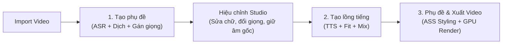

# DubStudio — Trình Lồng Tiếng & Vietsub Video AI (Trung → Việt)

[](https://github.com/Lurz0205/DubStudiobyHTB/releases)
[-38bdf8.svg)](https://github.com/Lurz0205/DubStudiobyHTB/releases)
[](LICENSE)
[](https://www.python.org/)

**DubStudio** là ứng dụng desktop Windows mã nguồn mở, hoạt động theo triết lý **cục bộ (Local-first)**, chuyên chuyển đổi tự động các video tiếng Trung (video ngắn, review phim, vlog đời sống, clip công nghệ, hoạt hình...) sang video thuyết minh/lồng tiếng Việt chuẩn ngữ cảnh, tự nhiên kèm phụ đề định dạng nâng cao (ASS).

Toàn bộ các mô hình AI hạng nặng (tách nhạc nền Kim_Vocal_2 / BS-RoFormer, nhận dạng giọng nói SenseVoice-Small / Whisper large-v3-turbo, tổng hợp giọng đọc thuyết minh VieNeu-TTS-v3 Turbo) đều được tối ưu hóa chạy trực tiếp trên GPU máy tính người dùng (NVIDIA RTX 4GB VRAM trở lên), đảm bảo tốc độ vượt trội, bảo mật dữ liệu tuyệt đối và hoàn toàn miễn phí trọn đời.

---

## 📥 Tải bản cài đặt sẵn cho Windows (Khuyến nghị)

Nếu bạn không muốn cài đặt Python hoặc cấu hình môi trường phức tạp:
👉 **[Tải xuống bản cài đặt mới nhất DubStudio v1.1.3 (DubStudio-win-Setup.exe)](https://github.com/Lurz0205/DubStudiobyHTB/releases/tag/v1.1.3)**

- **Cài đặt trong 10 giây**: Tải về và nhấp đúp file setup để sử dụng ngay.
- **Tự động cập nhật vi sai (Velopack Delta Update)**: Tự động kiểm tra và nâng cấp phiên bản mới siêu tốc chỉ với vài chục MB mà không cần tải lại toàn bộ app.
- **Độc lập hoàn toàn**: Tích hợp sẵn FFmpeg GPU nội bộ, tự động quản lý và tải mô hình AI vào thư mục dữ liệu chuẩn `DubStudioData\models`.

---

## 🌟 Điểm nổi bật trên phiên bản v1.1.3

### 1. Nâng cấp Giọng đọc TTS 200% Chuẩn Phát thanh & Khử Rè Tuyệt đối
- **Chuẩn hóa chuỗi xử lý 48kHz**: Nâng chất lượng âm thanh lên 48kHz triệt tiêu nhiễu răng cưa của TTS.
- **Bộ lọc EQ làm ấm & Khử chói**: Lọc bỏ tạp âm trầm dưới 80Hz, tăng cường độ dày ở 180Hz và giảm chói ở 5500Hz giúp giọng đọc ấm áp, tự nhiên.
- **Upward Compressor + Brickwall Limiter**: Khuếch đại âm lượng lên 200% tăng thực tế +8.4 đến +13.3 LUFS (tai người nghe to gấp đôi thực thụ), True Peak được kiểm soát mềm mại ở `-0.3 dBFS`, **0% clipping (không vỡ hạt rè)**.

### 2. Đồng bộ Phụ đề WYSIWYG 1:1 Tuyệt đối (Preview sao - Render vậy)
- **Sai số 0 pixel giữa Preview và Xuất video**: Sử dụng hệ thống đo đạc font `QFontMetrics` đồng bộ cùng hệ số chuẩn `libass` (1.116x).
- **Hộp nền đen (Background Box) che kín phụ đề gốc**: Hộp nền đen và kích thước chữ trên video thành phẩm khớp 100% với màn hình Preview, che kín hoàn toàn chữ tiếng Trung gốc bên dưới.

### 3. Cơ chế Rút gọn Lồng tiếng Thoát ý & Chống Hở Câu
- **Dịch thoát ý khẩu ngữ tự nhiên**: Định hướng AI dịch lại câu ngắn gọn, súc tích, giữ trọn nghĩa phim thay vì cắt gọt máy móc lủng củng.
- **Sàn ký tự `min_chars` thông minh**: Khóa chặt độ dài tối thiểu, triệt tiêu hoàn toàn khoảng lặng chết ("hở miệng") so với giọng nói video gốc.

### 4. Chuẩn hóa Quản lý Thư mục Dữ liệu & Xuất Video
- **Thư mục xuất chuẩn**: Video thành phẩm mặc định được lưu vào thư mục quen thuộc `Videos\DubStudio` (`C:\Users\<User>\Videos\DubStudio`).
- **Tương tác thuận tiện**: Tự động mở và bôi sáng (highlight) file video trong Windows Explorer, hỗ trợ nút "Đổi thư mục xuất" trực tiếp trên giao diện.

### 5. Quản lý Tài nguyên GPU & Đa kênh mượt mà
- **Tối ưu VRAM 4GB**: Stage Mutex Kernel tự động giải phóng bộ nhớ giữa các khâu nặng; dọn dẹp sạch tiến trình ngầm qua Windows Job Object.
- **Multi-track Preview**: Hỗ trợ khoanh vùng giữ âm gốc trực tiếp trên Timeline với chuyển tiếp chống click/pop 150ms.

---

## 🔄 Quy trình làm việc tiêu chuẩn (3 Bước)



1. **Bước 1 — Tạo phụ đề:** Chọn video tiếng Trung, chọn văn phong và bấm **"1. Tạo phụ đề"**.
2. **Bước 2 — Hiệu chỉnh & Tạo lồng tiếng:** Nghe thử, sửa chữ trực tiếp trên bảng, đổi giọng đọc hoặc khoanh vùng âm gốc rồi bấm **"2. Tạo lồng tiếng"**.
3. **Bước 3 — Xuất video:** Sang tab **"3. Phụ đề"** để chọn phong cách hiển thị chữ và bấm **"Xuất Video"**.

---

## ⌨️ Phím tắt & Thao tác chuột hữu ích

| Thao tác | Chức năng |
| :--- | :--- |
| **Phím Space (Cách)** | Phát / Tạm dừng video preview |
| **Phím Delete** | Xóa nhanh các lời thoại đang được chọn |
| **Ctrl + Click** | Chọn nhiều câu thoại cùng lúc trên bảng phụ đề |
| **Ctrl + F** | Mở thanh Tìm kiếm & Thay thế phụ đề |
| **Nhấp đúp vào dòng** | Mở hộp thoại chỉnh sửa chuyên sâu và ngắt nhịp câu |
| **Chuột phải trên bảng phụ đề** | Bật/tắt phụ đề, Bật/tắt giọng đọc TTS, Đổi giọng đọc hàng loạt, Xóa dòng |
| **Kéo chuột phải trên Track Âm gốc** | Tạo nhanh vùng giữ âm gốc trực tiếp trên Timeline |
| **Kéo 2 đầu mút khối trên Timeline** | Tùy chỉnh vị trí bắt đầu và kết thúc của lời thoại hoặc vùng âm gốc |

---

## 💻 Yêu cầu hệ thống

- **Hệ điều hành**: Windows 10 / Windows 11 (64-bit).
- **Bộ vi xử lý (CPU)**: Intel Core i5 thế hệ 10 / AMD Ryzen 5 3600 trở lên.
- **Bộ nhớ trong (RAM)**: Tối thiểu 8 GB (Khuyến nghị 12 GB - 16 GB trở lên).
- **Card đồ họa (GPU)**: NVIDIA GeForce RTX 2050 (4 GB VRAM) trở lên với driver hỗ trợ CUDA 12.x.
- **Dung lượng ổ cứng**: Tối thiểu 10 GB dung lượng trống (khuyến nghị ổ SSD).
- **Bản cài đặt sẵn**: Tích hợp sẵn toàn bộ công cụ, không yêu cầu cài đặt thêm môi trường.

---

## 🚀 Hướng dẫn khởi động từ mã nguồn

### 1. Yêu cầu môi trường
- Python **3.11** (Lưu ý: Không dùng Python 3.12 hoặc 3.14 do yêu cầu tương thích của PyTorch CUDA và CTranslate2).
- Cài đặt FFmpeg trên Windows (đã thêm vào PATH).

### 2. Cài đặt các thư viện
```powershell
# Kích hoạt môi trường ảo
.\.venv\Scripts\Activate.ps1

# Cài đặt các gói phụ thuộc
pip install -r requirements.txt --progress-bar off
```

### 3. Khởi chạy ứng dụng
```powershell
# Chạy trực tiếp qua file khởi động
.\.venv\Scripts\python.exe start_app.py
```

### 4. Chạy kiểm thử tự động (Unit Tests)
```powershell
.\.venv\Scripts\python.exe -m pytest tests/ -q
```

---

## 📁 Cấu trúc thư mục dự án

```
ToolDichThuat/
├── dubstudio/
│   ├── config.py, logging_setup.py, events.py, errors.py, jobstate.py, paths.py
│   ├── stages/             # Pipeline tuần tự (ingest, separate, asr, translate, tts, fit, mix, render)
│   ├── tts/                # Bộ phát giọng đọc VieNeu-TTS Turbo & Worker Server thường trực
│   ├── llm/                # Giao tiếp dịch thuật Gemini Flash / Web CDP & Prompts chuẩn hóa
│   ├── subtitles/          # Xử lý ASS subtitle, phân đoạn nhịp câu (cue_split) và liên kết câu
│   └── audio/              # Xử lý âm thanh, trích xuất tần số và crossfade
├── ui/
│   ├── app.py, main_window.py, icons.py, theme.py
│   ├── pages/              # Các trang giao diện: Studio, Settings, Translation Account, Help
│   ├── widgets/            # Timeline Ruler, Subtitle Editor, Video Player, Audio Mixer
│   └── dialogs/            # Hộp thoại tạo tác vụ, tự dịch thủ công, chỉnh sửa câu thoại
├── config/                 # default.toml, components.json, subtitle_preset.json
├── scripts/                # Scripts đóng gói PyInstaller, audit diff, release GitHub
├── tests/                  # Bộ 175+ kiểm thử đơn vị tự động (100% pass)
└── workspace/              # Thư mục lưu trạng thái và cache của từng video
```

---

## 📄 Bản quyền & Tuyên bố miễn trừ trách nhiệm

- Ứng dụng được phát triển hoàn toàn độc lập theo hình thức **Clean-room implementation**, không sao chép mã nguồn, tài nguyên hay giọng đọc từ bất kỳ phần mềm thương mại nào.
- Ứng dụng chỉ phục vụ mục đích biên dịch, học tập và sản xuất video cá nhân từ các tệp tin video nội bộ hợp pháp trên máy tính người dùng.

---
*Phát triển bởi đội ngũ DubStudio — Phiên bản v1.1.3 Stable.*
