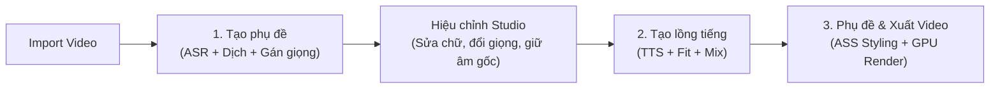

# DubStudio — Trình Lồng Tiếng & Vietsub Video AI (Trung → Việt)

[](https://github.com/Lurz0205/DubStudiobyHTB/releases)
[-38bdf8.svg)](https://github.com/Lurz0205/DubStudiobyHTB/releases)
[](LICENSE)
[](https://www.python.org/)

**DubStudio** là ứng dụng desktop Windows mã nguồn mở, hoạt động theo triết lý **cục bộ (Local-first)**, chuyên chuyển đổi tự động các video tiếng Trung (video ngắn, review phim, vlog đời sống, clip công nghệ, hoạt hình...) sang video thuyết minh/lồng tiếng Việt chuẩn ngữ cảnh, tự nhiên kèm phụ đề định dạng nâng cao (ASS).

Toàn bộ các mô hình AI hạng nặng (tách nhạc nền, nhận dạng tiếng Trung, tổng hợp giọng nói thuyết minh) đều được tối ưu hóa chạy trực tiếp trên card đồ họa máy tính người dùng (NVIDIA RTX 4GB VRAM trở lên), đảm bảo tốc độ xử lý nhanh, bảo mật dữ liệu tuyệt đối và hoàn toàn miễn phí trọn đời.

---

## 📥 Tải bản cài đặt sẵn cho Windows

👉 **[Tải xuống bản cài đặt DubStudio mới nhất (DubStudio-win-Setup.exe)](https://github.com/Lurz0205/DubStudiobyHTB/releases/latest)**

- **Cài đặt trong 1 click**: Tải về và nhấp đúp file setup để sử dụng ngay mà không cần cài đặt Python hay môi trường phức tạp.
- **Tự động cập nhật siêu tốc (Velopack Delta Update)**: Tự động kiểm tra và nâng cấp phiên bản mới nhanh chóng với các gói cập nhật vi sai dung lượng nhẹ.
- **Độc lập và tiện lợi**: Đã tích hợp sẵn FFmpeg tăng tốc GPU và cơ chế tự động quản lý mô hình AI.

---

## 🌟 Tính năng cốt lõi của DubStudio

### 1. Tách nhạc nền & Lời thoại AI (Vocal / BGM Separation)
- Sử dụng mô hình tách âm thanh tiên tiến (Kim_Vocal_2 / BS-RoFormer) để tách hoàn toàn giọng nói tiếng Trung ra khỏi nhạc nền và hiệu ứng âm thanh (SFX).
- Giữ nguyên vẹn 100% âm thanh môi trường, nhạc phim và tiếng động gốc.

### 2. Nhận dạng tiếng Trung chuẩn xác (Chinese ASR)
- Hỗ trợ linh hoạt cả **SenseVoice-Small** (siêu tốc, tích hợp VAD phân tách nhịp câu tự nhiên) và **Faster-Whisper large-v3-turbo** (chính xác cao cho video nhiều tạp âm).
- Tự động phân đoạn lời thoại và lấy mốc thời gian (timestamps) chuẩn xác tới từng mili-giây.

### 3. Dịch thuật theo ngữ cảnh & Nhận diện nhân vật thông minh
- Tận dụng trí tuệ ngữ cảnh của LLM (Gemini Flash / Web CDP): tự động nhận diện đại từ nhân xưng, vai vế xưng hô (cô, chú, anh, chị, em...) và giới tính nhân vật (nam/nữ) để gán giọng đọc tương ứng.
- Văn phong dịch thoát ý, tự nhiên, súc tích, đậm chất đời thường của người Việt.
- Hỗ trợ chế độ **Tự dịch thủ công (Manual Translation)**: Copy lời thoại ra ngoài dịch bằng ChatGPT/Claude/DeepSeek và dán lại trong 1 click.

### 4. Giọng đọc thuyết minh tiếng Việt tự nhiên (VieNeu-TTS Turbo)
- Tích hợp mô hình giọng đọc AI tiếng Việt chất lượng cao chạy offline hoàn toàn trên GPU.
- Hỗ trợ đa dạng giọng đọc nam/nữ nhiều vùng miền, ngữ điệu tự nhiên, truyền cảm.
- Chuỗi xử lý âm thanh phát thanh chuyên nghiệp: khử ồn trầm, khử chói kim loại, cho phép nâng âm lượng lên 200% uy lực mà không bị vỡ tiếng.

### 5. Khớp thời lượng & Nhịp điệu tự động (Audio-Video Fit)
- Tự động tính toán độ dài lời thoại tiếng Việt so với khoảng thời gian câu gốc trên video.
- Điều tốc thông minh và áp dụng cơ chế viết lại câu (Smart Fit Rewrite) súc tích, giữ trọn nghĩa phim, không làm câu bị hở nhịp hay kéo dài lấn sang câu sau.

### 6. Studio Preview đa kênh & Biên tập trực quan
- Trình phát video preview đồng bộ đa kênh: nghe thử và điều chỉnh âm lượng độc lập cho từng rãnh (Tiếng Việt lồng tiếng, Nhạc nền BGM, Âm thanh gốc).
- **Khoanh vùng Giữ âm gốc (Original Audio Passthrough)**: Dễ dàng kéo chọn trực tiếp trên Timeline các đoạn cần giữ tiếng gốc (tiếng khóc, cười, hát, thét, hiệu ứng đặc biệt) với chuyển tiếp mượt mà.

### 7. Xuất video chất lượng cao & Phụ đề ASS nâng cao
- Trình tạo phụ đề ASS chuẩn WYSIWYG (khớp 100% giữa màn hình Preview và video xuất ra).
- Hỗ trợ hộp nền đen (Background Box) bo góc sắc nét, che phủ hoàn toàn phụ đề tiếng Trung gốc bên dưới.
- Xuất video tận dụng phần cứng GPU (NVIDIA NVENC / Intel QSV) nhanh chóng, giữ trọn độ nét gốc của video.

---

## 🔄 Quy trình làm việc tiêu chuẩn (3 Bước)



1. **Bước 1 — Tạo phụ đề:** Nạp video, chọn văn phong mong muốn và nhấn **"1. Tạo phụ đề"**.
2. **Bước 2 — Hiệu chỉnh & Tạo lồng tiếng:** Nghe thử, tinh chỉnh câu chữ trực tiếp trên bảng, đổi giọng đọc hoặc khoanh vùng giữ âm gốc rồi nhấn **"2. Tạo lồng tiếng"**.
3. **Bước 3 — Xuất video:** Sang tab **"3. Phụ đề"** để chọn kiểu dáng hiển thị phụ đề và nhấn **"Xuất Video"**.

---

## ⌨️ Phím tắt & Thao tác chuột hữu ích

| Thao tác | Chức năng |
| :--- | :--- |
| **Phím Space (Cách)** | Phát / Tạm dừng video preview |
| **Phím Delete** | Xóa nhanh các lời thoại đang được chọn |
| **Ctrl + Click** | Chọn nhiều câu thoại cùng lúc trên bảng phụ đề |
| **Ctrl + F** | Mở thanh Tìm kiếm & Thay thế phụ đề |
| **Nhấp đúp vào dòng** | Mở hộp thoại chỉnh sửa chuyên sâu và ngắt nhịp câu |
| **Chuột phải trên bảng phụ đề** | Bật/tắt phụ đề, Bật/tắt giọng đọc TTS, Đổi giọng đọc hàng loạt, Xóa dòng |
| **Kéo chuột phải trên Track Âm gốc** | Tạo nhanh vùng giữ âm gốc trực tiếp trên Timeline |
| **Kéo 2 đầu mút khối trên Timeline** | Tùy chỉnh vị trí bắt đầu và kết thúc của lời thoại hoặc vùng âm gốc |

---

## 💻 Yêu cầu hệ thống

- **Hệ điều hành**: Windows 10 / Windows 11 (64-bit).
- **Bộ vi xử lý (CPU)**: Intel Core i5 thế hệ 10 / AMD Ryzen 5 3600 trở lên.
- **Bộ nhớ trong (RAM)**: Tối thiểu 8 GB (Khuyến nghị 12 GB - 16 GB trở lên).
- **Card đồ họa (GPU)**: NVIDIA GeForce RTX 2050 (4 GB VRAM) trở lên với driver hỗ trợ CUDA 12.x.
- **Dung lượng ổ cứng**: Tối thiểu 10 GB dung lượng trống (khuyến nghị ổ SSD).
- **Bản cài đặt sẵn**: Tích hợp sẵn toàn bộ công cụ, không yêu cầu cài đặt thêm môi trường.

---

## 🚀 Hướng dẫn khởi động từ mã nguồn (Dành cho lập trình viên)

### 1. Yêu cầu môi trường
- Python **3.11** (Lưu ý: Không dùng Python 3.12 hoặc 3.14 do yêu cầu tương thích của PyTorch CUDA và CTranslate2).
- Cài đặt FFmpeg trên Windows (đã thêm vào PATH).

### 2. Cài đặt các thư viện
```powershell
# Kích hoạt môi trường ảo
.\.venv\Scripts\Activate.ps1

# Cài đặt các gói phụ thuộc
pip install -r requirements.txt --progress-bar off
```

### 3. Khởi chạy ứng dụng
```powershell
# Chạy trực tiếp qua file khởi động
.\.venv\Scripts\python.exe start_app.py
```

### 4. Chạy kiểm thử tự động (Unit Tests)
```powershell
.\.venv\Scripts\python.exe -m pytest tests/ -q
```

---

## 📁 Cấu trúc thư mục dự án

```
ToolDichThuat/
├── dubstudio/
│   ├── config.py, logging_setup.py, events.py, errors.py, jobstate.py, paths.py
│   ├── stages/             # Pipeline tuần tự (ingest, separate, asr, translate, tts, fit, mix, render)
│   ├── tts/                # Bộ phát giọng đọc VieNeu-TTS Turbo & Worker Server thường trực
│   ├── llm/                # Giao tiếp dịch thuật Gemini Flash / Web CDP & Prompts chuẩn hóa
│   ├── subtitles/          # Xử lý ASS subtitle, phân đoạn nhịp câu (cue_split) và liên kết câu
│   └── audio/              # Xử lý âm thanh, trích xuất tần số và crossfade
├── ui/
│   ├── app.py, main_window.py, icons.py, theme.py
│   ├── pages/              # Các trang giao diện: Studio, Settings, Translation Account, Help
│   ├── widgets/            # Timeline Ruler, Subtitle Editor, Video Player, Audio Mixer
│   └── dialogs/            # Hộp thoại tạo tác vụ, tự dịch thủ công, chỉnh sửa câu thoại
├── config/                 # default.toml, components.json, subtitle_preset.json
├── scripts/                # Scripts đóng gói PyInstaller, audit diff, release GitHub
├── tests/                  # Bộ 175+ kiểm thử đơn vị tự động (100% pass)
└── workspace/              # Thư mục lưu trạng thái và cache của từng video
```

---

## 📄 Bản quyền & Tuyên bố miễn trừ trách nhiệm

- Ứng dụng được phát triển hoàn toàn độc lập theo hình thức **Clean-room implementation**, không sao chép mã nguồn, tài nguyên hay giọng đọc từ bất kỳ phần mềm thương mại nào.
- Ứng dụng chỉ phục vụ mục đích biên dịch, học tập và sản xuất video cá nhân từ các tệp tin video nội bộ hợp pháp trên máy tính người dùng.

---
*DubStudio — Trình lồng tiếng & Vietsub video AI cá nhân.*
