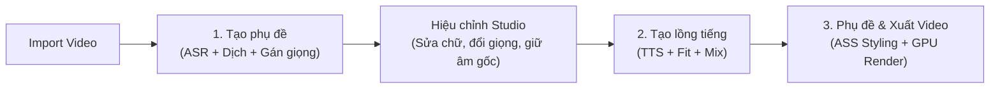

# DubStudio — Trình Lồng Tiếng & Vietsub Video AI (Trung → Việt)

[](https://github.com/Lurz0205/DubStudiobyHTB/releases)
[-38bdf8.svg)](https://github.com/Lurz0205/DubStudiobyHTB/releases)
[](LICENSE)
[](https://www.python.org/)

**DubStudio** là ứng dụng desktop Windows mã nguồn mở, hoạt động theo triết lý **cục bộ (Local-first)**, chuyên chuyển đổi tự động các video tiếng Trung (video ngắn, review phim, vlog đời sống, clip công nghệ, hoạt hình...) sang video thuyết minh/lồng tiếng Việt chuẩn ngữ cảnh, tự nhiên kèm phụ đề định dạng nâng cao (ASS).

Toàn bộ các mô hình AI hạng nặng (tách nhạc nền/giọng nói Kim_Vocal_2 / Demucs, nhận dạng giọng nói ASR Whisper large-v3-turbo, tổng hợp giọng đọc thuyết minh VieNeu-TTS-v3 Turbo) đều được tối ưu hóa chạy trực tiếp trên GPU máy tính người dùng (NVIDIA RTX 4GB VRAM trở lên), đảm bảo tốc độ vượt trội, bảo mật dữ liệu tuyệt đối và hoàn toàn miễn phí trọn đời.

---

## 📥 Tải bản cài đặt sẵn cho Windows (Khuyến nghị)

Nếu bạn không muốn cài đặt Python hoặc cấu hình môi trường phức tạp:
👉 **[Tải xuống bản cài đặt DubStudio v1.0.0 Stable (DubStudio-win-Setup.exe)](https://github.com/Lurz0205/DubStudiobyHTB/releases/tag/v1.0.0)**

- Tải về và nhấp đúp file setup để cài đặt trong vòng 10 giây.
- Ứng dụng tự động quản lý cập nhật và tải các thành phần AI khi cần.

---

## 🌟 Toàn cảnh tính năng nổi bật trên bản v1.0.0 Stable

### 1. Khoanh vùng Giữ âm gốc độc lập (Original Audio Passthrough)
- **Tách biệt 100% với phụ đề**: Lưu trữ độc lập trên timeline tại Track 3 chuyên biệt màu cam (`Âm gốc 🎵`), không bị ảnh hưởng khi chỉnh sửa hoặc xóa phụ đề.
- **Thao tác tạo vùng siêu tốc**:
  - **Kéo thả chuột phải**: Nhấp giữ chuột phải và kéo trực tiếp trên thanh Track Âm gốc để tạo vùng mong muốn tức thì.
  - **Nút "+ Vùng âm gốc"**: Tự động bắt vị trí con trỏ video đang phát và tạo vùng mặc định 5 giây để chỉnh sửa.
  - Hỗ trợ co kéo linh hoạt 2 đầu mút thời gian hoặc dịch chuyển vị trí bất kỳ lúc nào.
- **Chuyển tiếp siêu mượt (150ms Raised-Cosine S-Curve)**:
  - Khi phát qua vùng giữ âm gốc, hệ thống tự động tắt giọng đọc TTS và chuyển từ nhạc nền đã tách sang 100% âm thanh gốc của video.
  - Áp dụng thuật toán crossfade cosine nâng (raised cosine) 150ms giúp âm thanh chuyển tiếp mượt mà, triệt tiêu hoàn toàn hiện tượng giật cục, méo tiếng hay tiếng "pop/click".

### 2. Nhận diện Giới tính & Nhân vật thông minh theo ngữ cảnh (Context-Aware Gender)
- **Không dựa vào F0 cao độ âm thanh**: Khắc phục triệt để nhược điểm của các thuật toán đo tần số cao độ cũ (dễ bị nhạc nền, tạp âm hoặc tiếng la hét làm đoán sai lệch).
- **Gemini Context Tagging**: Tận dụng trí tuệ ngữ cảnh của Gemini ngay trong quá trình dịch thuật. AI tự động phân tích vai vế xưng hô, đại từ nhân xưng (他/她, cô/chú/anh/chị/em), tên gọi và ngữ cảnh đối thoại để xác định chính xác người nói là nam hay nữ.
- **Không tốn thêm tài nguyên**: Tích hợp sẵn trong luồng dịch, không tiêu tốn thêm 1 MB VRAM GPU nào và không cần tải thêm mô hình phân loại phụ.

### 3. Đổi giọng đọc linh hoạt & Bảo toàn lựa chọn người dùng
- **Đổi giọng câu lẻ trực tiếp**: Bất kỳ câu nào trên bảng phụ đề đều có thể nhấp chọn đổi sang giọng nam hoặc nữ tùy ý (Minh Đức, Hải Đăng, Trúc Ly, Quỳnh Anh...).
- **Đổi giọng hàng loạt siêu tốc**: Bôi đen các dòng cần đổi $\rightarrow$ Nhấp chuột phải $\rightarrow$ **"Đổi giọng đọc"** $\rightarrow$ Chọn Giọng Nam hoặc Giọng Nữ để áp dụng đồng loạt trong 1 click.
- **Khóa bảo toàn tuyệt đối**: Khi bạn bấm **"2. Tạo lồng tiếng"**, hệ thống tôn trọng 100% các câu bạn đã chọn giọng trên bảng, tuyệt đối không bị tiến trình ngầm nào ghi đè lại.
- **Cơ chế Hash sinh giọng thông minh**: Hệ thống chỉ sinh lại giọng đọc cho những câu bạn vừa đổi giọng hoặc vừa sửa chữ (tiết kiệm thời gian, không phải tạo lại toàn bộ video).

### 4. Tinh chỉnh đồng bộ thông minh (Intelligent Headroom Shifting)
- Khâu căn khớp tốc độ (`fit.py`) được trang bị cơ chế kiểm tra khoảng trống (gap headroom):
  - Khi câu thoại dịch dài hơn khung thời gian gốc, hệ thống tự động kiểm tra khoảng lặng phía trước và phía sau.
  - Cho phép **xê dịch linh hoạt tối đa 0.5s** vào khoảng trống để giữ tốc độ đọc tự nhiên, tránh bị ép nói quá nhanh.
  - Chỉ khi xê dịch 0.5s vẫn không đủ chỗ thì hệ thống mới kích hoạt vòng lặp viết lại (LLM rewrite) qua AI.

### 5. Chống ngắt câu lửng 4 tầng (Anti-Dangling 4-Layer)
- Triệt tiêu triệt để tình trạng AI dịch ngắt câu lửng lơ ở các cụm từ so sánh, bắc cầu (như `"tương đương."` hoặc `"so với."`):
  1. *Prompt Engineering*: Ràng buộc nghiêm ngặt cấu trúc câu trong prompt LLM.
  2. *Units Normalizer*: Tự động bảo vệ các từ nối bắc cầu (`相当于`, `类似于`, v.v.) không bị cắt vụn khi phân đoạn.
  3. *Style Linter*: Rà soát ngữ pháp và cú pháp câu tiếng Việt sau dịch.
  4. *Sentence Align & Stitcher*: Tự động ghép liền các câu bị cắt rời không hợp lý trước khi nạp vào bộ đọc TTS.

### 6. Hai chế độ Dịch thuật linh hoạt: Tự động qua Gemini & Tự dịch thủ công
- **Dịch tự động qua Gemini**: Hỗ trợ kết nối trực tiếp qua Google Gemini API hoặc chế độ duyệt web không cần API Key, tự động dịch thoát ý, chuẩn văn phong đời thường của người Việt.
- **Chế độ Tự dịch thủ công (Manual Translation)**: Không cần API key, không cần tài khoản. Hệ thống xuất toàn bộ lời thoại tiếng Trung kèm prompt chuyên nghiệp cho bạn copy sang ChatGPT/Claude/DeepSeek, sau đó chỉ cần dán kết quả trả lời vào hộp thoại để ứng dụng tự động bóc tách và nạp vào bảng phụ đề.

### 7. Menu chuột phải tinh giản & Tiện ích Studio
- **Bật / Tắt phụ đề**: Ẩn/hiện dòng phụ đề trên video mà vẫn bảo toàn bản dịch.
- **Bật / Tắt giọng đọc TTS**: Chủ động tắt thuyết minh ở những đoạn muốn giữ im lặng hoặc chỉ nghe nhạc nền.
- **Thao tác phím Delete nhanh**: Xóa một hoặc nhiều câu phụ đề được chọn bằng phím Delete trên bàn phím hoặc qua menu chuột phải.
- **Thanh tìm kiếm & Thay thế (Ctrl + F)**: Tìm từ ngữ, sửa nhanh tên riêng hoặc xóa hàng loạt trong phụ đề.
- **Bảng phụ đề tự động co dãn thông minh**: Cột "Nghe", cột thời gian và cột chỉ mục hiển thị rõ ràng, không bị che khuất hay hiện dấu `...`.

### 8. Xuất Video & Khắc cứng phụ đề ASS bằng phần cứng
- Render bằng FFmpeg tận dụng phần cứng GPU NVIDIA (`h264_nvenc`) hoặc Intel QuickSync (`h264_qsv`), fallback mượt mà sang CPU (`libx264`).
- Phụ đề kiểu dáng ASS tùy chỉnh màu sắc, viền, khung nền bo góc (box styling) và độ nét cao.

---

## 🔄 Quy trình làm việc tiêu chuẩn (3 Bước)



1. **Bước 1 — Tạo phụ đề:**
   - Chọn file video tiếng Trung từ máy tính.
   - Chọn văn phong dịch (Review phim, Hài hước, Tin tức, Đời thường...).
   - Bấm nút **"1. Tạo phụ đề"**: Hệ thống tự động trích xuất âm thanh, tách lời thoại, nhận dạng chữ Hán, gọi Gemini dịch sang tiếng Việt và phân loại giọng nam/nữ theo ngữ cảnh.
2. **Bước 2 — Hiệu chỉnh & Tạo lồng tiếng:**
   - Xem trước video và kiểm tra phụ đề trên bảng.
   - Nhấp đúp vào câu để chỉnh sửa chữ tiếng Việt hoặc nhấp vào ô Giọng để chọn giọng đọc mong muốn.
   - Sử dụng thanh Track 3 để khoanh vùng những đoạn cần giữ nguyên tiếng gốc của video (tiếng cười, tiếng động cơ, nhạc gốc...).
   - Bấm nút **"2. Tạo lồng tiếng"**: Hệ thống tạo giọng đọc tiếng Việt cho các câu cần thiết, căn khớp tốc độ và trộn âm thanh hoàn chỉnh.
3. **Bước 3 — Xuất video:**
   - Bấm nút **"3. Phụ đề"** để chuyển sang trang xuất bản.
   - Tùy chỉnh font chữ, kích cỡ, màu sắc, bóng đổ và viền phụ đề.
   - Bấm **"Xuất Video"** để xuất file thành phẩm với tốc độ mã hóa phần cứng GPU cực nhanh.

---

## ⌨️ Phím tắt & Thao tác chuột hữu ích

| Thao tác | Chức năng |
| :--- | :--- |
| **Phím Space (Cách)** | Phát / Tạm dừng video preview |
| **Phím Delete** | Xóa nhanh các lời thoại đang được chọn |
| **Ctrl + Click** | Chọn nhiều câu thoại cùng lúc trên bảng phụ đề |
| **Ctrl + F** | Mở thanh Tìm kiếm & Thay thế phụ đề |
| **Nhấp đúp vào dòng** | Mở hộp thoại chỉnh sửa chuyên sâu và ngắt nhịp câu |
| **Chuột phải trên bảng phụ đề** | Bật/tắt phụ đề, Bật/tắt giọng đọc TTS, Đổi giọng đọc hàng loạt, Xóa dòng |
| **Kéo chuột phải trên Track Âm gốc** | Tạo nhanh vùng giữ âm gốc trực tiếp trên Timeline |
| **Kéo 2 đầu mút khối trên Timeline** | Tùy chỉnh vị trí bắt đầu và kết thúc của lời thoại hoặc vùng âm gốc |

---

## 💻 Yêu cầu hệ thống

- **Hệ điều hành**: Windows 10 / Windows 11 (64-bit).
- **Bộ vi xử lý (CPU)**: Intel Core i5 thế hệ 10 / AMD Ryzen 5 3600 trở lên.
- **Bộ nhớ trong (RAM)**: Tối thiểu 8 GB (Khuyến nghị 12 GB - 16 GB trở lên).
- **Card đồ họa (GPU)**: NVIDIA GeForce RTX 2050 (4 GB VRAM) trở lên với driver hỗ trợ CUDA 12.x.
- **Dung lượng ổ cứng**: Tối thiểu 10 GB dung lượng trống (khuyến nghị ổ SSD).
- **Phần mềm phụ trợ**: `ffmpeg` đã được cài đặt và thêm vào biến môi trường `PATH`.

---

## 🚀 Hướng dẫn khởi động từ mã nguồn

### 1. Yêu cầu môi trường
- Python **3.11** (Lưu ý: Không dùng Python 3.12 hoặc 3.14 do yêu cầu tương thích của PyTorch CUDA và CTranslate2).
- Cài đặt Git và FFmpeg trên Windows.

### 2. Cài đặt các thư viện
```powershell
# Di chuyển vào thư mục dự án
cd C:\Users\sieut\Documents\ToolDichThuat

# Kích hoạt môi trường ảo
.\.venv\Scripts\Activate.ps1

# Cài đặt các gói phụ thuộc (nếu chưa cài)
pip install -r requirements.txt --progress-bar off
```

### 3. Khởi chạy ứng dụng
```powershell
# Chạy trực tiếp qua file khởi động
.\.venv\Scripts\python.exe start_app.py
```

### 4. Chạy kiểm thử tự động (Unit Tests)
```powershell
.\.venv\Scripts\python.exe -m pytest tests/ -q
```

---

## 📁 Cấu trúc thư mục dự án

```
ToolDichThuat/
├── dubstudio/
│   ├── config.py, logging_setup.py, events.py, errors.py, jobstate.py
│   ├── stages/             # Pipeline xử lý tuần tự (ingest, separate, asr, translate, tts, fit, mix, render)
│   ├── tts/                # Bộ phát giọng đọc VieNeu-TTS Turbo & Worker Server thường trực
│   ├── llm/                # Giao tiếp dịch thuật Gemini Flash / Web CDP & Prompts chuẩn hóa
│   ├── subtitles/          # Xử lý ASS subtitle, phân đoạn nhịp câu (cue_split) và liên kết câu
│   └── audio/              # Xử lý âm thanh, trích xuất tần số và crossfade
├── ui/
│   ├── app.py, main_window.py, icons.py, theme.py
│   ├── pages/              # Các trang giao diện: Studio, Settings, Translation Account, Help
│   ├── widgets/            # Timeline Ruler, Subtitle Editor, Video Player, Audio Mixer
│   └── dialogs/            # Hộp thoại tạo tác vụ, tự dịch thủ công, chỉnh sửa câu thoại
├── config/                 # default.toml, components.json
├── scripts/                # Scripts đóng gói PyInstaller, build runtime pack, release Velopack
├── tests/                  # Bộ kiểm thử đơn vị tự động (123+ tests)
├── workspace/              # Thư mục lưu trạng thái và cache của từng video
└── out/                    # Thư mục xuất video thành phẩm
```

---

## 📄 Bản quyền & Tuyên bố miễn trừ trách nhiệm

- Ứng dụng được phát triển hoàn toàn độc lập theo hình thức **Clean-room implementation**, không sao chép mã nguồn, tài nguyên hay giọng đọc từ bất kỳ phần mềm thương mại nào.
- Ứng dụng chỉ phục vụ mục đích biên dịch, học tập và sản xuất video cá nhân từ các tệp tin video nội bộ hợp pháp trên máy tính người dùng.

---
*Phát triển bởi đội ngũ DubStudio — Phiên bản v1.0.0 Stable.*
