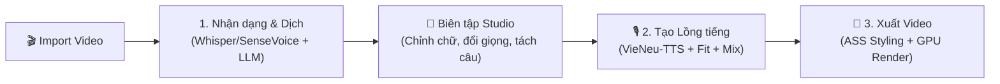

# DubStudio v2.0 — Trình Lồng Tiếng & Vietsub Video AI (Trung → Việt)

[](https://github.com/Lurz0205/DubStudiobyHTB/releases)
[-38bdf8.svg)](https://github.com/Lurz0205/DubStudiobyHTB/releases)
[-f59e0b.svg)](https://github.com/Lurz0205/DubStudiobyHTB)
[](https://www.python.org/)
[](LICENSE)

**DubStudio** là ứng dụng desktop Windows mã nguồn mở cao cấp, hoạt động theo triết lý **cục bộ (Local-first)**, chuyên chuyển đổi tự động các video tiếng Trung (video ngắn, review phim, vlog đời sống, clip công nghệ, hoạt hình...) sang video thuyết minh/lồng tiếng Việt chuẩn ngữ cảnh, tự nhiên kèm phụ đề định dạng nâng cao (ASS).

Toàn bộ các mô hình AI hạng nặng (tách nhạc nền, nhận dạng tiếng Trung, tổng hợp giọng nói thuyết minh) đều được tối ưu hóa chạy trực tiếp trên card đồ họa máy tính người dùng (NVIDIA RTX 4GB VRAM trở lên), đảm bảo tốc độ xử lý nhanh, bảo mật dữ liệu tuyệt đối và hoàn toàn miễn phí trọn đời.

---

## 📥 Tải Bản Cài Đặt Sẵn Cho Windows

👉 **[Tải xuống bản cài đặt DubStudio mới nhất (DubStudio-win-Setup.exe)](https://github.com/Lurz0205/DubStudiobyHTB/releases/latest)**

- **Cài đặt trong 1 click**: Tải về và nhấp đúp file setup để sử dụng ngay mà không cần cài đặt Python hay môi trường phức tạp.
- **Tự động cập nhật siêu tốc (Velopack Update)**: Tự động kiểm tra và nâng cấp phiên bản mới nhanh chóng với các gói cập nhật dung lượng nhẹ.
- **Độc lập và tiện lợi**: Tích hợp sẵn FFmpeg tăng tốc GPU và cơ chế tự động quản lý mô hình AI thông minh.

---

## 🌟 Những Điểm Đột Phá Trên DubStudio v2.0

### 1. Kiến Trúc Next-Gen Studio — Trải Nghiệm Mượt Mà & Tinh Tế
- **Thiết kế phẳng Neutral Charcoal Matte (`#121214` / `#161619`)**: Giao diện chuẩn studio chuyên nghiệp, không gây mỏi mắt, phân khu làm việc khoa học.
- **Triệt tiêu 100% lỗi xung đột mạng (Zero Hardcoded Port)**: Loại bỏ hoàn toàn cổng tĩnh `8765`, sử dụng cơ chế cấp phát cổng động ngẫu nhiên kết hợp Native In-Memory Bridge. Không bao giờ lo xung đột cổng mạng hay bị phần mềm diệt virus chặn.
- **Khóa giao diện Zero-Failure (Inline CSS Guarantee)**: Nhúng trực tiếp toàn bộ CSS vào bộ nhớ giao diện, bảo đảm 100% lần mở app đều hiển thị chuẩn đẹp, không bao giờ mất khung hay lỗi giao diện.

### 2. Thuật Toán Rút Gọn Câu Thoát Ý Thông Minh (Fit Rewrite Vi Phẫu)
- **Đo nhịp theo âm tiết tiếng Việt (`tts_words`)**: Khắc phục triệt để tình trạng AI cắt quá ngắn gây hở khoảng lặng. Đo chính xác tốc độ phát âm thực tế để tính toán ngân sách từ vừa khít.
- **Biên tập vi phẫu 2 cấp độ**: Ưu tiên giữ lại 85–90% câu gốc và chỉ gọt tỉa các từ đệm thừa ("thì", "mà", "là"). Chỉ diễn đạt lại khi câu thực sự vượt thời lượng.
- **Chốt chặn chống hụt thời lượng (Anti-Underflow Guardrail)**: Tự động hoàn tác câu gốc nếu AI rút gọn quá tay, bảo đảm video luôn đầy đặn và truyền cảm.

### 3. Loại Bỏ Hoàn Toàn PyQt6 — Nhẹ Hơn & Khớp Từng Pixel
- Gỡ bỏ hoàn toàn thư viện Qt6, giúp bản đóng gói giảm hơn **72 MB** dung lượng.
- Bộ đo chiều rộng chữ phụ đề chuyển sang **Windows Native GDI** của hệ điều hành, đảm bảo độ chuẩn xác 100% từng pixel giữa màn hình xem trước và video xuất ra.

### 4. Bàn Hòa Âm Đỉnh Cao (Web Audio API Limiter 0% – 200%)
- Hỗ trợ phóng đại âm lượng giọng đọc lên tới **+20.0 dB** (mức 200%).
- Tích hợp **Brickwall Peak Limiter** bảo vệ âm thanh khỏi hiện tượng vỡ tiếng kỹ thuật số, khử chói và chống méo tiếng tuyệt đối.
- Tự động hạ nhạc nền thông minh (**Auto-Ducking**) khi có giọng thuyết minh cất lên.

### 5. Trình Phát WYSIWYG & Biên Tập Dòng Thời Gian Trực Quan
- Màn hình xem trước video hiển thị phụ đề và hộp nền đen (Background Box) che kín chữ Trung Quốc gốc chuẩn 100% như video xuất ra.
- Hỗ trợ linh hoạt cả tỉ lệ **16:9 gốc** lẫn mở rộng tỉ lệ dọc **9:16** chuyên cho TikTok/Shorts/Reels.
- Dòng thời gian Timeline đa rãnh: Phụ đề, Giọng đọc TTS, và Rãnh giữ âm thanh gốc (Original Audio Passthrough).

---

## 🔄 Quy Trình Làm Việc Tiêu Chuẩn (3 Bước)



1. **Bước 1 — Nhận dạng & Dịch thuật:** Nạp video cục bộ, chọn văn phong mong muốn và nhấn **"1. Tạo phụ đề"**.
2. **Bước 2 — Biên tập & Tạo lồng tiếng:** Nghe thử từng câu, tinh chỉnh nội dung nếu cần, chọn giọng đọc nam/nữ hoặc khoanh vùng giữ âm gốc rồi nhấn **"2. Tạo lồng tiếng"**.
3. **Bước 3 — Xuất video:** Sang tab **"Xuất video"** tùy chỉnh kiểu chữ, màu sắc, khung viền, logo và nhấn **"Bắt đầu xuất video"**.

---

## ⌨️ Phím Tắt Tiện Dụng

| Phím tắt / Thao tác | Chức năng |
| :--- | :--- |
| **Spacebar (Phím cách)** | Phát / Tạm dừng video xem trước toàn cục |
| **Nhấp đúp chuột vào câu** | Mở bảng chỉnh sửa chi tiết nội dung, tốc độ và nghe thử câu |
| **Chuột phải trên câu** | Mở menu thao tác nhanh: Bật/tắt phụ đề, Bật/tắt TTS, Đổi giọng đọc |
| **Kéo 2 đầu mút trên Timeline** | Căn chỉnh thời điểm bắt đầu / kết thúc của câu phụ đề |
| **Nút "Tách tự động"** | Tự động phân tách dòng phụ đề theo số từ ước lượng bằng thuật toán quy hoạch động |

---

## 💻 Yêu Cầu Hệ Thống

- **Hệ điều hành**: Windows 10 / Windows 11 (64-bit).
- **Bộ vi xử lý (CPU)**: Intel Core i5 thế hệ 10 / AMD Ryzen 5 3600 trở lên.
- **Bộ nhớ RAM**: Tối thiểu 8 GB (Khuyến nghị 12 GB – 16 GB).
- **Card đồ họa (GPU)**: NVIDIA GeForce RTX 2050 (4 GB VRAM) trở lên hỗ trợ CUDA 12.x.
- **Dung lượng ổ cứng**: Tối thiểu 10 GB dung lượng trống (khuyến nghị ổ SSD).

---

## 🛠️ Hướng Dẫn Dành Cho Nhà Phát Triển (Development)

```powershell
# 1. Kích hoạt môi trường Python 3.11
.venv\Scripts\Activate.ps1

# 2. Cài đặt các thư viện phụ thuộc
pip install -r requirements.txt

# 3. Biên dịch giao diện React
cd frontend
npm install
npm run build
cd ..

# 4. Khởi chạy ứng dụng DubStudio v2.0
python start_app.py

# 5. Chạy bộ kiểm thử tự động
pytest tests/ -q
```

---

## 📄 Bản Quyền & Giấy Phép

Dự án được phân phối dưới giấy phép mã nguồn mở **MIT License**. Tự do sử dụng, chỉnh sửa và triển khai cho các mục đích cá nhân và thương mại.
